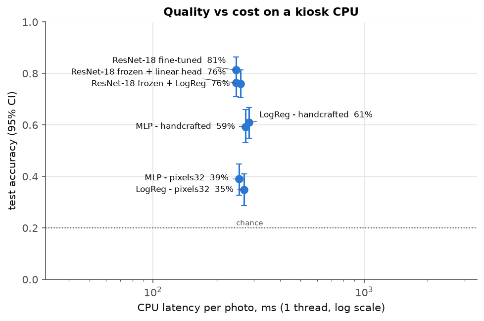

# Museum Art Guide

Final project for the Neural Networks & Deep Learning course.

A (fictional) museum wants a visitor guide on kiosks that only have modest CPUs. The director asks, for both parts
of the guide: **is a neural network worth it, or would a classical model be enough?**

- **Part 1, classification:** recognise the style of a painting from a visitor's photo (5 WikiArt styles:
  Impressionism, Baroque, Cubism, Ukiyo-e, Pop Art).
- **Part 2, search:** answer free-text questions such as "Which painting shows a stormy sea?" with a ranked list
  of artworks.

The three deliverables:

- a feed-forward network written from PyTorch primitives: `src/museum_guide/mlp.py`, `scripts/02_train_mlp.py`
- training monitoring and failure diagnosis: `src/museum_guide/training.py`, `scripts/03_diagnose_mlp.py`
- a pretrained ResNet-18: `src/museum_guide/resnet.py`, `scripts/04_train_resnet.py`

Every number below comes from the committed files in `results/` (one Colab run from commit 747ac0e, plus the
laptop benchmark from the same commit). `python scripts/check_readme_numbers.py` checks that each percentage,
latency, size and precision in this README appears in those files.

## Short answer

**Classification: yes, a neural network, but a pretrained one used as a feature extractor.** We recommend
ResNet-18 frozen + logistic regression: 75.9 % test accuracy against 61.0 % for the best classical model
(hand-crafted features), a difference that is clearly significant (paired test below). It takes 65.3 ms per phone
photo on one core of the 2-vCPU cloud machine and 45 MB on disk, and it retrains on a CPU in 18.6 s (Colab 2-vCPU). Fine-tuning
scored 81.3 %, but the gap to the recommended model (5.4 points) is not significant once corrected for multiple
comparisons, it disappears on painters the model has never seen (34.4 % vs 34.3 %), and retraining it is much
heavier (one epoch takes 34.6 s on the Colab 2-vCPU machine, and the GPU run needed 14 epochs). Fine-tuning is
the alternative if accuracy on paintings by known painters matters more to the museum than retraining cost.

**Search: yes, a neural network (CLIP) for questions about what a painting shows.** On 20 content questions
judged by hand, CLIP puts 0.550 relevant images in its top 10 on average (precision@10), the keyword baseline
0.025 and a random ranking 0.005. The keyword baseline only knows the catalogue (style, genre, artist), so it
cannot find a stormy sea. The price is 115.7 ms per question on one core and a 605 MB model. For catalogue
questions ("a cubist painting") keywords are as good (precision@10 0.867 vs 0.833) at 1.09 ms.

## Data

5 styles from WikiArt, 300 images each, 128 px centre crops, built with the course script
`scripts/make_wikiart_subset.py` (exact command in `scripts/build_dataset.sh`, dataset revision pinned). Images
are not in the repo (unknown licence). After the duplicate verdicts below, 1496 images remain:
train / val / test = 1032 / 223 / 241.

### Leakage: what we checked and what we fixed

A test image is only a fair test if the model has not seen the same painting, or the same painter, in training.

- **Hidden painters.** Most images are labelled "Unknown Artist": 100 % of Impressionism and Pop Art, 96 % of
  Baroque, 86 % of Cubism, 85 % of Ukiyo-e (`results/00_explore/eda.json`). The split is grouped by artist, so the
  15 named painters never appear in two splits, but an unknown image can share its painter with a training image
  and we cannot see it. WikiArt has only 1 named Pop Art and 2 named Ukiyo-e painters, so a better subset of these
  styles does not exist. We therefore **measured** the cost of unseen painters on a second subset where every
  painter is known (step 8, below).
- **Duplicate scans.** We searched all pairs of images for near-copies with ResNet embeddings (cosine similarity)
  and a perceptual hash, and one of us judged the 15 candidate pairs by eye: 6 the same image, 2 the same hidden
  painter, 1 the same composition, 6 different (`annotations/wikiart_style5_duplicates.csv`,
  `results/00_explore/duplicates_report.json`). The split now keeps every duplicate group in one split. One scan
  appeared twice, once labelled Cubism (train) and once Pop Art (test); images whose copies carry conflicting
  labels are removed (4 images). Before the verdicts, 1 test image had a training near-copy (cosine ≥ 0.86);
  after, none. The 0.86 rule agrees with 14 of the 15 human verdicts; the most similar pair of *different*
  paintings by the same named painter reaches only 0.839.
- **Why not compare with a random split?** A random split puts different images in the test set, so the two
  accuracies are not comparable on their own: logistic regression on hand-crafted features gets 61.0 % with the
  artist split and 54.8 % with a random split. Step 8 measures the leakage properly.

## Part 1: classification results

Test set of 241 images, chance = 20 %, 95 % bootstrap intervals. Latency = median time for one phone photo
(4032×3024 JPEG, 2.8 MB) on **one thread**, decoding included, with the kiosk preprocessing explained below.
Two machines: the 2-vCPU Colab machine (`results/05_benchmark`) is the closer stand-in for a modest kiosk; the
Apple M5 laptop (`results/05_benchmark_laptop`) is an upper bound, not a kiosk.

| model | test accuracy [95 % CI] | over 3 seeds | latency, 2-vCPU machine | latency, M5 laptop | size |
|---|---|---|---|---|---|
| Logistic regression, raw pixels 32×32 | 34.9 % [28.6, 41.1] | - | 42.2 ms | 16.8 ms | 0.14 MB |
| Logistic regression, hand-crafted features | 61.0 % [54.8, 66.8] | - | 58.2 ms | 19.8 ms | 0.09 MB |
| MLP from scratch, raw pixels | 39.0 % [32.8, 44.8] | 38.5 % ± 1.0 | 41.6 ms | 16.6 ms | 6.85 MB |
| MLP from scratch, hand-crafted features | 59.3 % [53.1, 66.0] | 57.1 % ± 5.0 | 57.8 ms | 19.8 ms | 10.74 MB |
| ResNet-18 frozen + linear head | 76.3 % [71.0, 81.7] | - | 63.8 ms | 21.2 ms | 44.80 MB |
| **ResNet-18 frozen + logistic regression** (recommended) | **75.9 % [70.5, 81.3]** | - | **65.3 ms** | **21.4 ms** | **44.81 MB** |
| ResNet-18 fine-tuned (layer4 + head) | 81.3 % [76.3, 86.3] | - | 63.8 ms | 21.2 ms | 44.80 MB |

The accuracy column is the saved model (for the MLPs, seed 0, the model that is benchmarked); "over 3 seeds" is
the mean ± std of the MLP over training seeds. Full table with macro-F1 and training time:
`results/summary.md`; quality vs cost: `results/tradeoff.png`.



### Are the differences real? Paired tests

All models are tested on the same 241 images, so we compare them image by image instead of checking whether
confidence intervals overlap. For each pair: the accuracy difference with a 95 % interval from a paired bootstrap,
and an exact McNemar test on the images where only one of the two models is right. Six comparisons are made, so
the p-values are corrected with Holm's method (`results/summary.md`).

| recommended vs | difference | only recommended right | only other right | Holm-corrected p |
|---|---|---|---|---|
| LogReg, raw pixels | +41.1 points | 112 | 13 | 4.87e-20 |
| LogReg, hand-crafted | +14.9 points | 61 | 25 | 0.000391 |
| MLP, raw pixels | +36.9 points | 105 | 16 | 1.58e-16 |
| MLP, hand-crafted | +16.6 points | 69 | 29 | 0.000263 |
| ResNet frozen + linear head | −0.4 points | 4 | 5 | 1 |
| ResNet fine-tuned | −5.4 points | 14 | 27 | 0.119 |

The pretrained features beat every model trained from scratch. Fine-tuning is the only open case: its bootstrap
interval (−10.4 to −0.4 points) just excludes zero, but the McNemar test after correction does not (p = 0.119),
so the evidence that fine-tuning helps is weak on 241 images.

### Observations

- **The MLP does not beat logistic regression on the same inputs.** On raw pixels it overfits within a few
  epochs: training accuracy 79.1 % while the best validation accuracy is 42.6 % (`results/03_diagnosis`, the
  reference run, identical to step 2's seed 0: test 39.0 % in both).
- **A head that starts at the right loss.** A softmax over 5 classes should start at loss ln 5 ≈ 1.61. The
  ResNet linear head with plain Xavier init started at 3.13 and reached 75.1 %; with standardised inputs and a
  small output init it starts at 1.60 and reaches 76.3 %, level with the logistic regression on the same
  features (paired difference −0.4 points, p = 1) (`results/04_resnet/frozen/summary.json`, head ablation).
- **Top-2 accuracy of the recommended model is 95.0 %.** Its most frequent error is Cubism predicted as Pop Art:
  13 of the 54 Cubism test images (from the predictions stored in `results/04_resnet/frozen/summary.json`).
- **Hyper-parameters were chosen on validation only.** The logistic regression C grid goes from 1e-5 to 10 and the
  chosen values (1e-3, and 1e-2 on ResNet features) are inside it, not at its edge.

### Unseen painters (step 8)

To measure what hidden painters may add to the main accuracy, step 8 uses a second subset of 1500 images where
every painter is known: the 5 styles with the most named painters (Impressionism, Post-Impressionism, Realism,
Romanticism, Symbolism; only Impressionism is shared with the main task), at most 50 images per painter. Each model, with the hyper-parameters selected above, is
trained with 5-fold cross-validation twice: random folds (test painters also seen in training) and
painter-disjoint folds (`results/08_unseen_painters/summary.md`).

| model | random folds | painter-disjoint folds | cost of unseen painters |
|---|---|---|---|
| LogReg, raw pixels | 33.3 % | 24.4 % | 8.9 points |
| LogReg, hand-crafted | 36.9 % | 29.1 % | 7.8 points |
| MLP, raw pixels | 31.2 % | 24.7 % | 6.5 points |
| MLP, hand-crafted | 34.4 % | 25.9 % | 8.5 points |
| ResNet frozen + linear head | 51.9 % | 33.3 % | 18.7 points |
| ResNet frozen + LogReg | 52.3 % | 34.3 % | 18.0 points |
| ResNet fine-tuned | 54.4 % | 34.4 % | 20.0 points |

Knowing the painter is worth 18 to 20 points to the ResNets and 6.5 to 8.9 points to the classical models: part of
what the ResNet learns is the painter's hand, not only the style. The ranking does not change (ResNet first), but
the main test accuracy is probably optimistic for paintings by painters the model has not seen. These are
different styles from the main task, so the cost cannot be subtracted from the main numbers as is.

### Deliverable 2: monitoring and failure diagnosis

We broke the MLP on purpose to check that the monitoring shows each problem (`results/03_diagnosis/summary.md`):
zero initialisation gives zero gradients in the hidden layers and 100 % dead units; a deep sigmoid network has a
first-layer gradient 7.5e-5 times the output layer's; a learning rate that is too low gives an update/weight ratio
around 1e-5; one that is too high kills 50 % of the ReLUs; with shuffled labels the model reaches 100 % on train and
18.3 % on test (chance), so the pipeline does not leak labels; a random split instead of the artist split raises the
test accuracy from 39.0 % to 44.7 %. The learning-rate range test is judged on validation loss: 3e-4 is best
(1.403) and the 1e-3 used in step 2 is close (1.426).

## Part 2: search results

Collection: the same 1496 artworks, at 224 px for CLIP (`data/wikiart_style5_224`, same images and ids).

- **Neural: CLIP ViT-B/32** (OpenAI weights, `open_clip`). Images and text are embedded in one space; the image
  embeddings are computed once, offline (3.1 MB). On the kiosk only the text encoder runs, then a dot product.
- **Classical: TF-IDF** on each artwork's catalogue text (style, genre, artist), character n-grams.
- **Random ranking** as a floor.

Precision@k = share of relevant images in the top k (`results/07_search/summary.md`).

| system | metadata queries, P@10 | content queries, P@5 | content queries, P@10 | latency, 2-vCPU machine | latency, M5 laptop | size |
|---|---|---|---|---|---|---|
| CLIP | 0.833 | 0.650 | 0.550 | 115.7 ms | 10.9 ms | 605 MB + index 3.1 MB |
| TF-IDF | 0.867 | 0.020 | 0.025 | 1.09 ms | 0.24 ms | 0.43 MB |
| random | 0.222 | 0.000 | 0.005 | - | - | - |

- **Metadata queries** (9: the 5 styles and 4 genres) are scored automatically from the catalogue. TF-IDF reads the
  very field that defines the answer, so its score is an upper bound, not a fair win.
- **Content queries** (20, e.g. "a stormy sea", "a skull", "a bottle or a glass") are judged by hand: the top 10 of
  every system were pooled, shuffled and shown without saying which system found them; 721 (query, image) pairs
  were judged (`search_eval/judgments.csv`). CLIP wins on every content query except "a waterfall" (all systems 0).
- **Latency, one thread.** On the 2-vCPU machine we use step 7's measurement (115.7 ms per question, of which
  89.6 ms is the text encoder). Step 5 timed the same thing separately (118.01 ms); we report step 7's value
  everywhere. On the laptop the only measurement is step 5's (10.9 ms).

## The kiosk preprocessing (why 65 ms and not 259 ms)

A visitor's phone photo is 12 megapixels; the models need 128 px. Decoding every pixel and then shrinking costs
259.1 ms for the recommended model on the 2-vCPU machine, almost all of it decoding. JPEG can instead decode
directly at 1/2, 1/4 or 1/8 of the size (`im.draft()`), then we crop and resize to 128 px with `ImageOps.fit`. This
is exactly how the training images were made, so the kiosk sees what the model was trained on, and it takes
65.3 ms (40.6 ms → 21.4 ms on the laptop). Phones also store photos sideways with an orientation tag; the kiosk
turns them upright first (`ImageOps.exif_transpose`), otherwise the model would see a rotated painting.

Retraining cost on CPU (`training_cost` in the benchmark files): the recommended model takes 18.6 s on the Colab
2-vCPU machine (12.6 s on the M5 laptop), almost all of it computing the ResNet features of the 1032 training
images. One fine-tuning epoch takes 34.6 s on the Colab 2-vCPU machine (20.3 s on the M5 laptop); on the Colab GPU,
fine-tuning ran 14 epochs.

## Limitations

- **Hidden painters.** Most images have no known painter, so the main test set cannot guarantee unseen painters.
  On a named-painter subset, unseen painters cost the ResNets 18 to 20 points (step 8); the main accuracy is
  probably optimistic.
- **Small test set.** 241 images: the recommended model's 95 % interval runs from 70.5 % to 81.3 %; differences of a few points (fine-tuned
  vs frozen) cannot be settled.
- **WikiArt scans are not visitor photos.** Accuracy was never measured on real photos taken in a gallery
  (reflections, angle, frame). The phone photo was only used to time the pipeline.
- **HEIC decoding not measured.** iPhones save HEIC; our phone photo was converted to JPEG (`sips`) before timing.
  A kiosk receiving HEIC would pay a decoding cost we did not measure.
- **Latency machines.** The 2-vCPU cloud machine is a stand-in for a kiosk, not a kiosk; the laptop is an upper
  bound. CLIP needs about 605 MB of model on disk; the kiosk's memory was not checked.
- **Search judged by a single person.** One judge (one of us) made all 721 verdicts, blind to the system. There is
  no second judge, so no inter-annotator agreement.
- **Judge consistency: 91 %.** After CLIP was switched to the activation its weights were trained with
  (QuickGELU), its new top 10 contained 67 unjudged pairs, all from CLIP: judging them alone would not have been
  blind. We mixed in 67 already-judged pairs from the same lists as decoys, shuffled. The first verdicts stay
  official; on the decoys the judge agreed with themself 91 % of the time (36 relevant twice, 25 not relevant
  twice, 6 changed). Self-agreement is not agreement between two judges.
- **Pooled judging.** Only images in some system's top 10 were judged. "A waterfall" has 0 relevant images among
  its 33 judged ones, so every system scores 0 there; it stays in the mean, and we cannot tell whether the
  collection has a waterfall at all.
- **Genre queries on 270 images.** Most artworks have no genre in the catalogue, so the 4 genre queries are scored
  only on the 270 with a known genre ("a landscape" has 8 relevant images among them).
- **The keyword baseline was fixed once, openly.** "A baroque painting" first retrieved "genre painting" records,
  because the word "painting" outweighed "baroque" (precision 0.00). We added a fixed list of words every artwork
  matches (painting, picture, image, artwork) and it reached 1.00. This helps the baseline, not CLIP, and it is
  the only change made after seeing results; it is disclosed in `results/07_search/summary.md`.
- **Phrasing matters.** The brief's own wording "Which painting shows a stormy sea?" gets precision@10 0.40 with
  CLIP against 0.50 for "a stormy sea" (8 of the 10 images shared); TF-IDF returns the same list for both and finds
  nothing. Visitors' wording will vary more than our 20 queries.
- **CLIP may have seen WikiArt.** CLIP was pretrained on images from the web, which likely include WikiArt
  paintings, so its search quality here may be higher than on a museum's own photos.
- **Python version.** The Colab run used Python 3.13.15; `requirements-lock.txt` was verified on Python 3.11 (the
  laptop and CI). The exact versions are recorded in every result file's provenance.
- **Superseded runs.** A first full run (commit 1cc52a4) was replaced: CLIP was then built with the wrong
  activation, and the deployable classifier file only opened on machines with a GPU. The classification results
  were identical in both runs.

## Reproducibility

Every result JSON carries a `provenance` block: git commit, whether the code had uncommitted changes, Python and
library versions, the exact command, and a fingerprint of the dataset (metadata + image bytes + duplicate verdicts).
`results/summary.md` lists the commit behind each file. The benchmark refuses a checkpoint trained on a different
dataset.

## How to run

```bash
python3.11 -m venv .venv && .venv/bin/pip install -r requirements-lock.txt -e .
.venv/bin/python -m pytest -q             # unit tests, no download needed

bash scripts/build_dataset.sh             # main subset -> data/wikiart_style5
bash scripts/build_named_dataset.sh       # named-painter subset for step 8 -> data/wikiart_named5
bash scripts/run_all.sh                   # steps 00 to 08, outputs in results/
.venv/bin/python scripts/check_readme_numbers.py   # every number in this README is in results/
```

The full run was done with `notebooks/colab_run_all.ipynb` on Google Colab (GPU runtime).

## Structure

```
src/museum_guide/   data and split, features, baseline, MLP, training loop, ResNet, search, metrics, plots
scripts/            00_explore.py ... 08_unseen_painters.py, run_all.sh, dataset scripts, README check
annotations/        duplicate verdicts (image ids only, made by hand)
search_eval/        search queries and relevance judgments (made by hand)
notebooks/          Colab notebook
tests/              unit tests
results/            metrics (JSON) and figures from the full run
```
